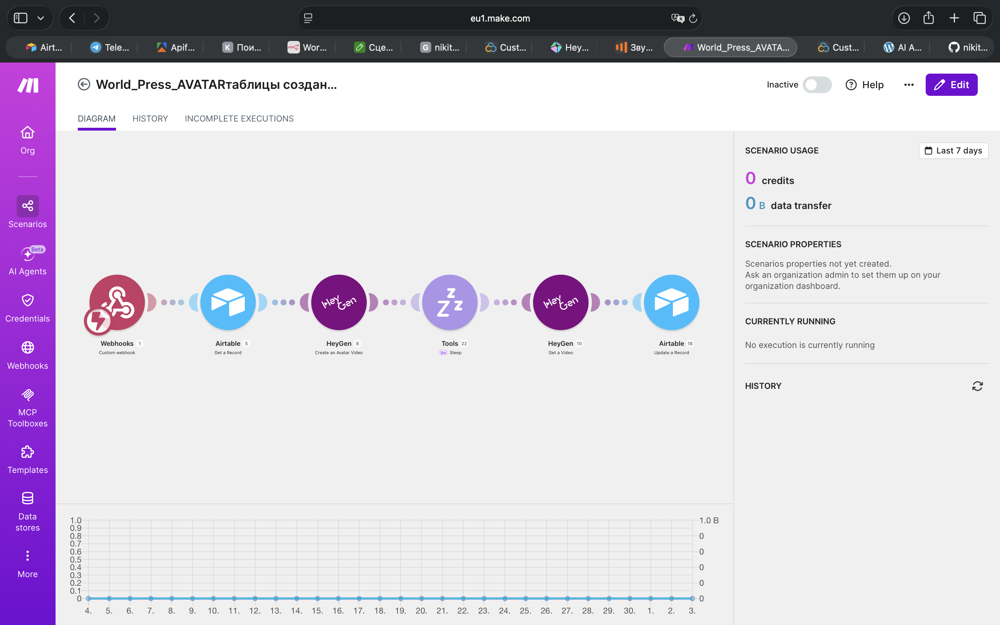

# AI Avatar Generator

AI Avatar Generator is a portfolio project demonstrating an automation workflow for generating AI avatar videos with the HeyGen API. The workflow is triggered from Airtable after the main content production process has already been completed: the script is written, the voice has been generated, and the user has selected an Avatar ID for the final video.

This project is one module in a broader AI content automation pipeline. It focuses on the final avatar video generation step and shows how Airtable, Make.com, HeyGen, and webhooks can be connected into a controlled production workflow.

## Business Problem

Creating AI avatar videos manually requires repeating the same operational steps for every video:

- selecting an avatar
- uploading or referencing generated audio
- starting the rendering process
- waiting for completion
- retrieving the final video
- copying the video URL
- updating the project status

This becomes repetitive when producing content regularly. Even when the creative work is already complete, the final rendering stage can still require manual coordination across several tools. Without automation, project records can become outdated, generated video links may be copied incorrectly, and the production pipeline becomes harder to track.

## Solution

This workflow automates the HeyGen avatar video generation process directly from Airtable. After the script and voice file are ready, the user selects an Avatar ID in Airtable and starts the automation by pressing a button or triggering a webhook.

Make.com receives the request, retrieves the related Airtable record, sends the required data to HeyGen, waits for the video rendering process, retrieves the generated video URL, and updates the original Airtable record automatically. The result is a structured workflow where avatar generation is connected to the existing content production system instead of being handled as a separate manual task.

## Workflow

```text
Webhook
  ↓
Airtable
  ↓
HeyGen
(Create Avatar Video)
  ↓
Wait
  ↓
HeyGen
(Get Video)
  ↓
Airtable
(Update Record)
```

The workflow follows a controlled sequence:

1. The content production process is completed before this workflow starts.
2. A script has already been written and stored in Airtable.
3. A voice file has already been generated and linked to the same Airtable record.
4. The user selects an Avatar ID in Airtable.
5. The user presses a button or triggers the webhook from the Airtable interface.
6. Make.com receives the webhook request.
7. The automation retrieves the Airtable record and required fields.
8. The workflow sends the Avatar ID, script-related data, and audio reference to HeyGen.
9. HeyGen starts rendering the avatar video.
10. The workflow waits for the rendering process to finish.
11. Make.com requests the completed video from HeyGen.
12. The generated video URL is retrieved.
13. Airtable is updated with the video URL, status, timestamp, and review information.
14. The record becomes ready for the next content production or publishing step.

## Technologies

| Technology | Purpose |
| --- | --- |
| Make.com | Workflow orchestration and scenario execution |
| HeyGen API | Avatar video generation and video retrieval |
| Airtable | Production database and user-facing control interface |
| Webhooks | Triggering the automation from Airtable |

## Business Value

The workflow reduces manual work in the final stage of AI content production. Instead of opening HeyGen manually, selecting an avatar, starting a render, waiting for completion, and copying the final URL back into Airtable, the user can trigger the process directly from the production record.

This makes avatar generation part of a structured content pipeline. It improves operational clarity because Airtable remains the central source of truth for status, source assets, generated video links, and review information. The automation is especially useful when individual videos need to be generated with predefined avatars and tracked consistently.

## Practical Experience

During development and testing, this workflow proved useful for specific production situations, especially when generating individual avatar videos from predefined scripts, voice files, and Avatar IDs. The Airtable-triggered approach gives the user direct control over when rendering starts, which is helpful when human review is required before video generation.

Testing also showed that this workflow is not always the most efficient option for large-scale production of many avatar videos. For high-volume generation, other workflow designs can be more efficient, such as batching, queue-based processing, or alternative production paths that reduce waiting time between renders.

This was an engineering decision based on practical workflow evaluation. The project remains valuable as a controlled avatar generation module, while larger production scenarios may require a different architecture.

## Screenshot


